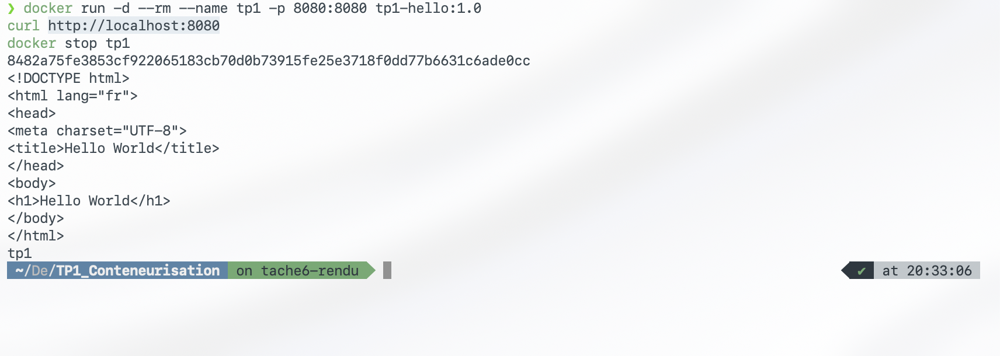
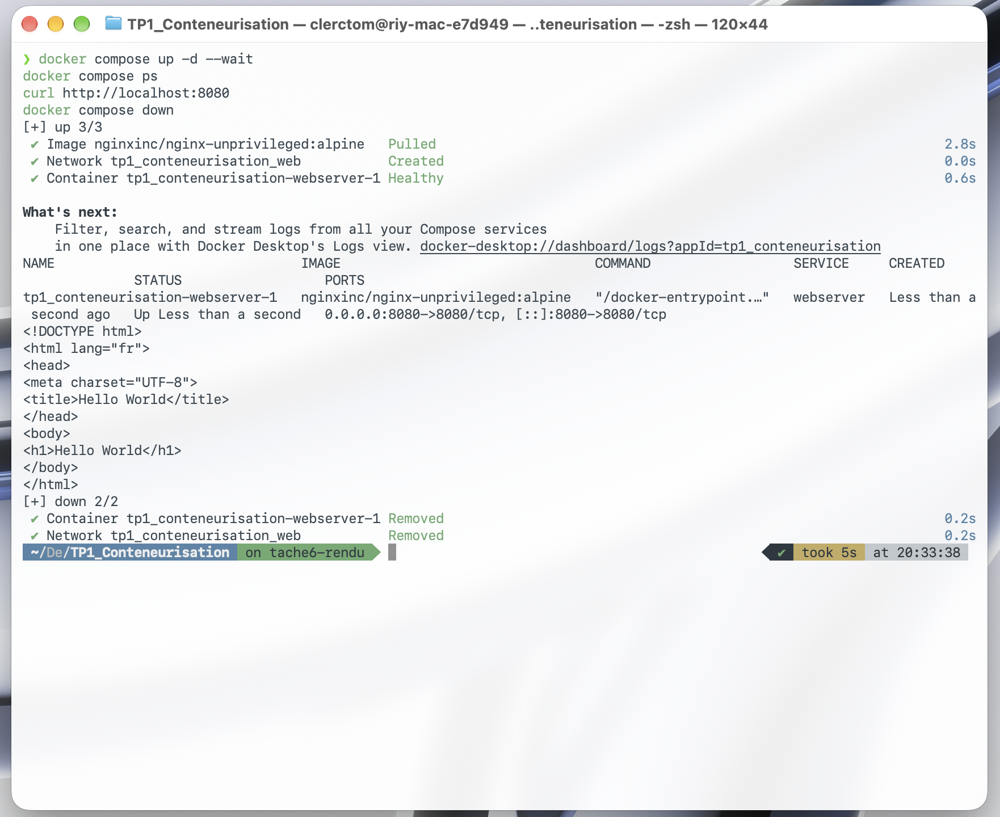
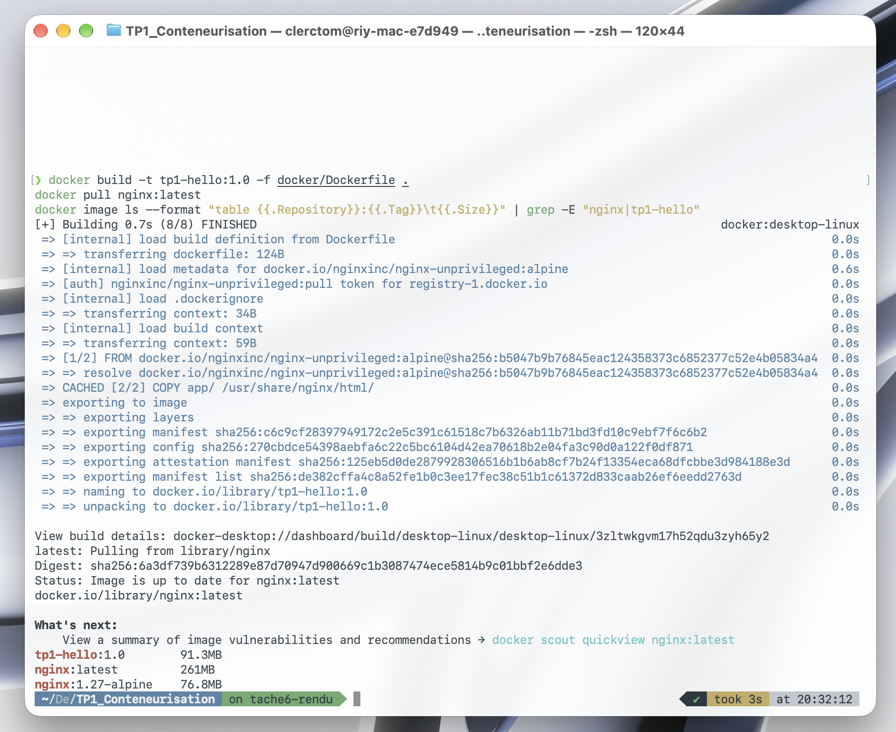
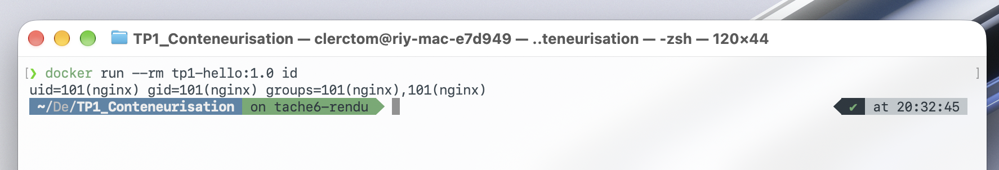
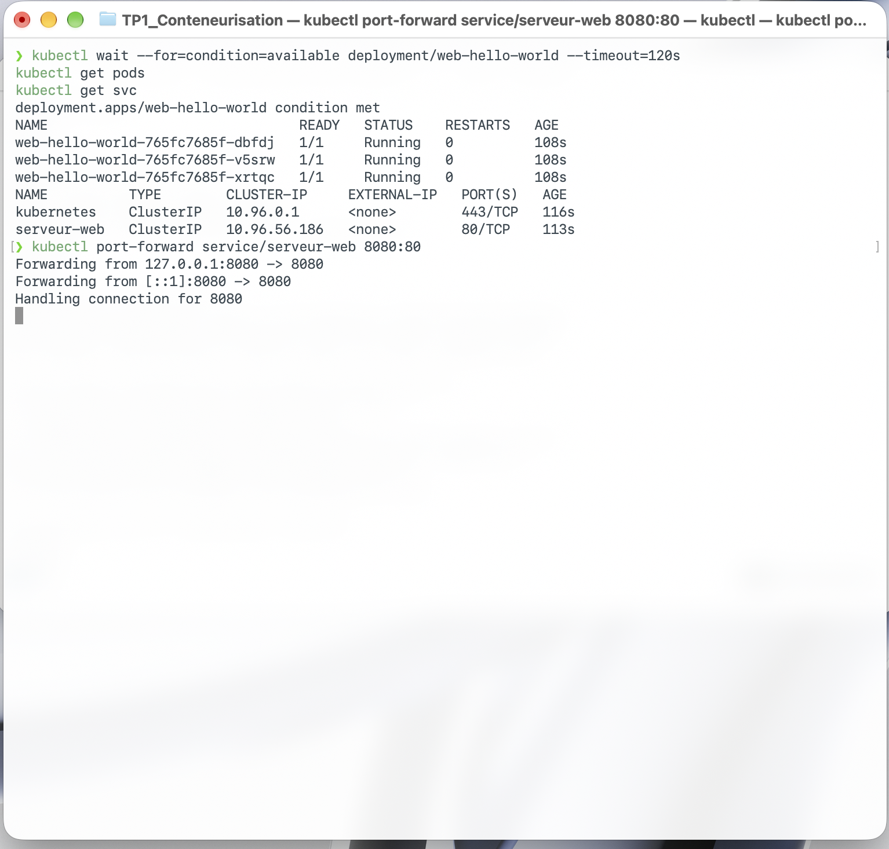
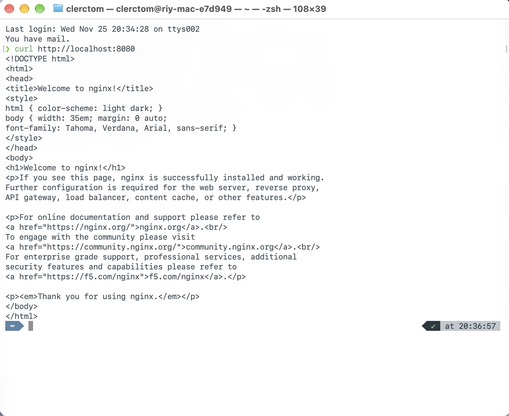

# TP1 : Conteneurisation avec Docker et Kubernetes


Conteneurisation d'une page web statique (Hello World) avec nginx, optimisation et sécurisation de l'image, déploiement sur un cluster Kubernetes local, puis analyse comparative VM contre conteneur.

## Sommaire

- [Consigne](#consigne)
- [Organisation du dépôt](#organisation-du-dépôt)
- [Choix techniques](#choix-techniques)
- [Prérequis et exécution](#prérequis-et-exécution)
- [Comment tester](#comment-tester)
- [Tâche 1 : Dockerfile](#tâche-1--dockerfile)
- [Tâche 2 : Optimisation et sécurité](#tâche-2--optimisation-et-sécurité)
- [Tâche 3 : Déploiement Kubernetes](#tâche-3--déploiement-kubernetes)
- [Tâche 4 : Ressources et scalabilité](#tâche-4--ressources-et-scalabilité)
- [Tâche 5 : VM contre conteneur](#tâche-5--vm-contre-conteneur)
- [TP5 : Sécurisation de Kubernetes et du pipeline](#tp5--sécurisation-de-kubernetes-et-du-pipeline)
- [Répartition des tâches](#répartition-des-tâches)
- [Équipe](#équipe)

## Consigne

Objectif : comprendre les principes de la conteneurisation, comparer machines virtuelles et conteneurs, et déployer une application conteneurisée en appliquant les bonnes pratiques de sécurité.

| Tâche | Intitulé |
|-------|----------|
| 1 | Créer un Dockerfile pour conteneuriser l'application |
| 2 | Optimiser l'image (taille, utilisateur non-root, sécurité) |
| 3 | Déployer l'application sur Kubernetes (Deployment, Service) |
| 4 | Configurer les ressources (CPU, mémoire) et la scalabilité (replicas) |
| 5 | Analyser les différences entre VM et conteneur |

## Organisation du dépôt

```
.
├── app/                 page web (Hello World)
├── docker/Dockerfile    image de l'application
├── compose.yml          lancement local avec Docker Compose
├── .dockerignore        fichiers exclus du contexte de build
├── .gitignore           fichiers non suivis (.env)
├── k8s/                 manifests Kubernetes (Deployment, Service)
│   └── securite/        namespace, RBAC, Network Policy, pods de test
├── kind/                configuration du cluster (audit, chiffrement)
├── doc/                 analyse VM contre conteneur, répartition des tâches, captures
├── .github/workflows/   CI GitHub Actions
└── requirements.txt     outils à installer
```

## Choix techniques

| Choix | Raison |
|-------|--------|
| Page statique dans `app/` | Rester simple pour se concentrer sur la conteneurisation |
| `nginxinc/nginx-unprivileged:alpine` | Image légère, utilisateur non-root, port 8080 non privilégié |
| Docker Compose | Lancement local en une commande, avec durcissement du conteneur |
| `kind` et `kubectl` | Cluster Kubernetes local dans Docker, identique sur Mac, Windows et Linux |
| GitHub Actions | `docker compose up` à chaque push et pull request vers `main` |
| Branche `main` protégée | Le check `compose` doit être vert avant tout merge |
| `.gitattributes` (fins de ligne LF) | Même comportement sur Mac et Windows |

## Prérequis et exécution

Les commandes d'installation de Docker, kubectl et kind pour Mac, Windows et Linux sont dans [requirements.txt](requirements.txt). Docker Desktop doit être lancé.

Toutes les commandes se lancent depuis la racine du dépôt.

| Étape | Commande |
|-------|----------|
| Construire l'image | `docker build -t tp1-hello:1.0 -f docker/Dockerfile .` |
| Lancer le conteneur | `docker run -d --rm --name tp1 -p 8080:8080 tp1-hello:1.0` |
| Arrêter le conteneur | `docker stop tp1` |
| Lancer avec Compose | `docker compose up -d --wait` |
| Arrêter Compose | `docker compose down` |
| Créer le cluster | `kind create cluster --name tp1` |
| Créer le namespace | `kubectl apply -f k8s/securite/namespace.yaml -f k8s/securite/rbac.yaml` |
| Déployer | `kubectl apply -f k8s/deployment.yaml -f k8s/service.yaml` |
| Attendre les pods | `kubectl wait --for=condition=available -n web deployment/web-hello-world --timeout=120s` |
| Accéder au site | `kubectl port-forward -n web service/serveur-web 8080:80` |
| Supprimer le cluster | `kind delete cluster --name tp1` |

Le site est disponible sur http://localhost:8080.

## Comment tester

Cinq étapes, dans l'ordre. Chaque étape indique ce qu'on doit voir si tout fonctionne.

### Étape 1 : installer les outils (requirements.txt)

`requirements.txt` n'est pas un fichier à exécuter : il contient les commandes à copier dans un terminal. Ouvrir le terminal, coller le bloc de son système, puis lancer les trois commandes de vérification.

| | Mac | Windows | Linux |
|---|-----|---------|-------|
| Terminal à ouvrir | Terminal | PowerShell en administrateur | Terminal |
| Installer Docker | `brew install --cask docker` | `winget install -e --id Docker.DockerDesktop` | `curl -fsSL https://get.docker.com \| sh` |
| Installer kubectl et kind | `brew install kubectl kind` | `winget install -e --id Kubernetes.kubectl` puis `winget install -e --id Kubernetes.kind` | commandes `curl` du fichier |
| Après l'installation | Lancer Docker Desktop | Lancer Docker Desktop, redémarrer PowerShell | `sudo usermod -aG docker $USER`, puis se reconnecter |

Les commandes complètes de chaque système sont dans [requirements.txt](requirements.txt).

Vérification, la même sur les trois systèmes :

```
docker version
kubectl version --client
kind version
```

Ce qu'on doit voir : `docker version` affiche une partie `Client` et une partie `Server`, les deux autres affichent un numéro de version. Si la partie `Server` manque, Docker Desktop n'est pas lancé.

### Étape 2 : récupérer le projet

```
git clone git@github.com:CLERC-Tom/TP1_Conteneurisation.git
cd TP1_Conteneurisation
```

### Étape 3 : tester Docker

| Commande | Ce qu'on doit voir |
|----------|--------------------|
| `docker build -t tp1-hello:1.0 -f docker/Dockerfile .` | Le build se termine sans erreur |
| `docker run --rm tp1-hello:1.0 id` | `uid=101(nginx)`, donc pas root |
| `docker compose up -d --wait` | Le conteneur passe à `Healthy` |
| `curl http://localhost:8080` (sous Windows : `curl.exe http://localhost:8080`) | La page `Hello World` |
| `docker compose down` | Le conteneur et le réseau sont supprimés |

### Étape 4 : tester Kubernetes

| Commande | Ce qu'on doit voir |
|----------|--------------------|
| `kind create cluster --name tp1` | `Set kubectl context to "kind-tp1"` |
| `kubectl apply -f k8s/securite/namespace.yaml -f k8s/securite/rbac.yaml` | 4 objets `created` |
| `kubectl apply -f k8s/deployment.yaml -f k8s/service.yaml` | Deployment et Service `created` |
| `kubectl wait --for=condition=available -n web deployment/web-hello-world --timeout=120s` | `condition met` |
| `kubectl get pods -n web` | 3 pods `1/1 Running` |
| `kubectl port-forward -n web service/serveur-web 8080:80` puis, dans un second terminal, `curl http://localhost:8080` | La page d'accueil de nginx |
| `kind delete cluster --name tp1` | Le cluster est supprimé |

### Étape 5 : tester la sécurité (TP5)

Cette étape se lance sur Mac et Linux. Sous Windows, il faut passer par WSL2 : le cluster monte des fichiers depuis `/tmp`. Les commandes et les résultats attendus sont dans la section [TP5](#tp5--sécurisation-de-kubernetes-et-du-pipeline). Pour voir les contrôles du pipeline, ouvrir l'onglet Actions du dépôt GitHub : les jobs `secrets`, `manifestes` et `image` doivent être verts.

## Tâche 1 : Dockerfile

Le fichier `docker/Dockerfile` part d'une base nginx non-root, met à jour les paquets système (correction des vulnérabilités, voir le TP5), copie `app/` et expose le port 8080.

```
FROM nginxinc/nginx-unprivileged:alpine

USER root
RUN apk upgrade --no-cache
USER 101

COPY app/ /usr/share/nginx/html/

EXPOSE 8080
```

Test avec `docker build` puis `docker run` : la page Hello World est servie sur le port 8080.



Le même résultat avec Docker Compose, le conteneur passe à l'état `Healthy` :



Compose utilise l'image publique `nginxinc/nginx-unprivileged:alpine` et monte `app/` en lecture seule, il ne construit pas `tp1-hello:1.0`.

## Tâche 2 : Optimisation et sécurité

### Taille de l'image

| Image | Taille | Utilisateur | Commentaire |
|-------|--------|-------------|-------------|
| `nginx:latest` | 261 Mo | root | Référence avant optimisation |
| `nginx:1.27-alpine` | 76,8 Mo | root | Légère, mais s'exécute en root |
| `tp1-hello:1.0` (avant la mise à jour des paquets) | 91,3 Mo | non-root (uid 101) | Alpine et non-root |
| `tp1-hello:1.0` (notre image finale) | 112 Mo | non-root (uid 101) | Alpine, non-root et 0 vulnérabilité HIGH ou CRITICAL |

Notre image finale est environ 57 % plus petite que `nginx:latest` (261 Mo contre 112 Mo). Elle pèse 35 Mo de plus que `nginx:1.27-alpine`, un surcoût accepté pour ne pas tourner en root et corriger les vulnérabilités. La capture ci-dessous a été prise avant la mise à jour des paquets (91,3 Mo).



### Bonnes pratiques de sécurité

| Pratique | Mise en oeuvre | Où |
|----------|----------------|----|
| Utilisateur non-root | `nginx-unprivileged`, uid 101 | Dockerfile |
| Port non privilégié | 8080 au lieu de 80 | Dockerfile, Compose |
| Paquets système à jour | `apk upgrade` dans le Dockerfile, 14 vulnérabilités corrigées dans l'image `tp1-hello` | Dockerfile |
| Pas de secrets dans l'image | `.dockerignore` exclut `.env`, `.git` et tout ce qui est hors `app/` | `.dockerignore` |
| Système de fichiers en lecture seule | `read_only: true`, `/tmp` en tmpfs de 16 Mo | `compose.yml` |
| Aucune capability Linux | `cap_drop: ALL` | `compose.yml` |
| Pas d'élévation de privilèges | `no-new-privileges:true` | `compose.yml` |
| Limites de ressources | 128 Mo de mémoire sans swap, 0,5 CPU | `compose.yml` |
| Réseau dédié | réseau `web` au lieu de `docker0` | `compose.yml` |

Preuve du non-root avec `docker run --rm tp1-hello:1.0 id` :



## Tâche 3 : Déploiement Kubernetes

Le cluster est un cluster local `kind`, piloté avec `kubectl`.

| Objet | Fichier | Caractéristiques |
|-------|---------|------------------|
| Deployment `web-hello-world` | `k8s/deployment.yaml` | namespace `web`, image `nginxinc/nginx-unprivileged:alpine`, label `app: hello-world` |
| Service `serveur-web` | `k8s/service.yaml` | namespace `web`, ClusterIP, port 80 vers le port 8080 des pods |

Les trois pods passent à `Running` et le Service répond via `kubectl port-forward` :



La page servie est la page d'accueil par défaut de nginx : le Deployment utilise l'image nginx publique et non `tp1-hello:1.0`.



## Tâche 4 : Ressources et scalabilité

| Paramètre | Valeur |
|-----------|--------|
| Replicas | 3 |
| CPU demandé (requests) | 100m |
| Mémoire demandée (requests) | 64Mi |
| CPU maximum (limits) | 250m |
| Mémoire maximum (limits) | 128Mi |

Pour changer le nombre de replicas :

```
kubectl scale -n web deployment web-hello-world --replicas=5
```

## Tâche 5 : VM contre conteneur

L'analyse complète est dans [doc/analyse VM contre conteneur.md](doc/analyse%20VM%20contre%20conteneur.md).

| Critère | Machine virtuelle | Conteneur |
|---------|-------------------|-----------|
| Isolation | Forte, par le matériel et l'hyperviseur | Logique, par le noyau partagé |
| Sécurité | Surface d'attaque étroite | Une faille du noyau expose l'hôte |
| Démarrage | Dizaines de secondes à minutes | Moins d'une seconde à quelques secondes |
| Poids | Plusieurs Go | Quelques dizaines de Mo |
| Portabilité | Liée à l'hyperviseur | Image OCI identique du poste au cloud |
| Compatibilité OS | Tout OS invité | Même noyau que l'hôte |

La VM reste la référence quand l'isolation prime. Le conteneur s'impose quand la vitesse, la densité et la portabilité priment.

## TP5 : Sécurisation de Kubernetes et du pipeline

Suite du TP1 : durcissement du cluster puis pipeline qui bloque les déploiements non conformes. Les manifests sont dans `k8s/securite/` et la configuration du cluster dans `kind/`. Les sorties de scan sont dans `doc/securite/` et la synthèse des risques dans [doc/securite/synthese-risques.md](doc/securite/synthese-risques.md).

### Cluster durci

Toutes les commandes se lancent depuis la racine du dépôt (Mac et Linux). La clé de chiffrement est générée au lancement et n'est jamais commitée.

```
sed "s|CLE_A_GENERER|$(head -c 32 /dev/urandom | base64)|" kind/encryption-config.yaml > /tmp/encryption-config.yaml
kind create cluster --name tp5 --config kind/kind-config.yaml
kubectl apply -f k8s/securite/namespace.yaml -f k8s/securite/rbac.yaml
kubectl apply -f k8s/deployment.yaml -f k8s/service.yaml -f k8s/securite/demo-backend-database.yaml
```

### Ce qui est mis en place

| Contrôle | Fichier | Résultat attendu |
|----------|---------|------------------|
| RBAC limité au namespace | `k8s/securite/rbac.yaml` | `app-sa` lit les pods du namespace `web`, rien d'autre |
| Pod Security `restricted` | `k8s/securite/namespace.yaml` | Un pod root ou privilégié est refusé |
| Network Policy deny-all | `k8s/securite/networkpolicy.yaml` | Seul le backend atteint la database sur le port 5432 |
| Deployment durci | `k8s/deployment.yaml` | Non-root uid 10101, lecture seule, `drop ALL`, seccomp, probes, image par digest |
| Secret hors manifeste | `kubectl create secret` | Aucune valeur dans le dépôt, chiffré dans etcd |
| Journal d'audit | `kind/audit-policy.yaml` | Chaque action d'un utilisateur est tracée |

### Tests

RBAC : les droits du compte de service `app-sa`.

```
kubectl auth can-i get pods -n web --as=system:serviceaccount:web:app-sa
kubectl auth can-i delete pods -n web --as=system:serviceaccount:web:app-sa
kubectl auth can-i get secrets -n web --as=system:serviceaccount:web:app-sa
```

| Action | Résultat |
|--------|----------|
| Lire les pods du namespace `web` | autorisé |
| Supprimer un pod | refusé |
| Lire les Secrets | refusé |
| Lire les pods du namespace `default` | refusé |

Pod Security : `kubectl apply -f k8s/securite/pod-privilegie-test.yaml` est rejeté (privileged, root, capabilities, seccomp).

Network Policy, avant puis après l'application de `k8s/securite/networkpolicy.yaml` :

```
kubectl -n web exec backend -- wget -qO- -T 3 http://database:5432
kubectl -n web exec intrus -- wget -qO- -T 3 http://database:5432
```

| Pod | Avant la policy | Après la policy |
|-----|-----------------|-----------------|
| `backend` | répond | répond |
| `intrus` | répond | bloqué |

Secret :

```
kubectl -n web create secret generic db-secret --from-literal=password="$(head -c 12 /dev/urandom | base64)"
```

Dans etcd, la valeur est chiffrée (préfixe `k8s:enc:aescbc:v1:cle1`).

Audit : après `kubectl -n web get pods --as=utilisateur-test`, l'action est retrouvée dans le journal du noeud.

```
docker exec tp5-control-plane grep utilisateur-test /var/log/kubernetes/audit.log
```

Elle apparaît avec l'utilisateur `utilisateur-test`, l'action `list` sur les pods du namespace `web` et le code 403.

### Scans

Trivy (image) et Checkov (manifests), avant et après correction. Sorties complètes : [scan-avant.txt](doc/securite/scan-avant.txt) et [scan-apres.txt](doc/securite/scan-apres.txt).

| Outil | Avant | Après |
|-------|-------|-------|
| Checkov, manifests `k8s/` | 16 alertes | 0 alerte |
| Trivy, image, HIGH et CRITICAL | 14 vulnérabilités | 0 vulnérabilité |

Périmètre : avant, les deux manifests de `main` (`deployment.yaml` et `service.yaml`) ; après, le dossier `k8s/` sans les pods de démonstration et de test, volontairement non conformes. Trivy scanne l'image `tp1-hello:1.0` construite par le Dockerfile. Le Deployment utilise l'image publique épinglée par digest, qui garde ses vulnérabilités tant qu'elle n'est pas reconstruite (voir la synthèse des risques).

Corrections faites : `securityContext` complet et seccomp, uid élevé, disque en lecture seule, probes, `imagePullPolicy: Always`, image par digest, namespace dédié, token de compte de service désactivé, `apk upgrade` dans le Dockerfile.

### Pipeline

Le workflow `.github/workflows/securite.yml` tourne à chaque push et pull request vers `main`.

| Job | Outil | Rôle |
|-----|-------|------|
| `secrets` | gitleaks | Cherche des secrets dans l'historique |
| `manifestes` | Checkov | Analyse les manifests `k8s/` |
| `image` | Trivy | Bloque si l'image a une vulnérabilité HIGH ou CRITICAL |
| `deploiement` | kind | Déploie dans un cluster de test, lancé à la main avec l'environnement `production` |

Le job `deploiement` ne démarre que si les trois contrôles passent. Les risques qui restent sont dans [doc/securite/synthese-risques.md](doc/securite/synthese-risques.md).

## Répartition des tâches

| Tâche | Intitulé | Responsable |
|-------|----------|-------------|
| 1 | Dockerfile | Tom et Thomas |
| 2 | Optimiser et sécuriser l'image | Thomas |
| 3 | Déployer sur Kubernetes | Aymeric |
| 4 | Ressources et scalabilité | Antoine |
| 5 | Analyse VM contre conteneur | Julie |
| 6 | Rendu | Tom |

Le suivi détaillé est dans [doc/repartition-des-taches.md](doc/repartition-des-taches.md).

## Équipe

Projet réalisé par Tom, Aymeric, Thomas, Antoine et Julie.
