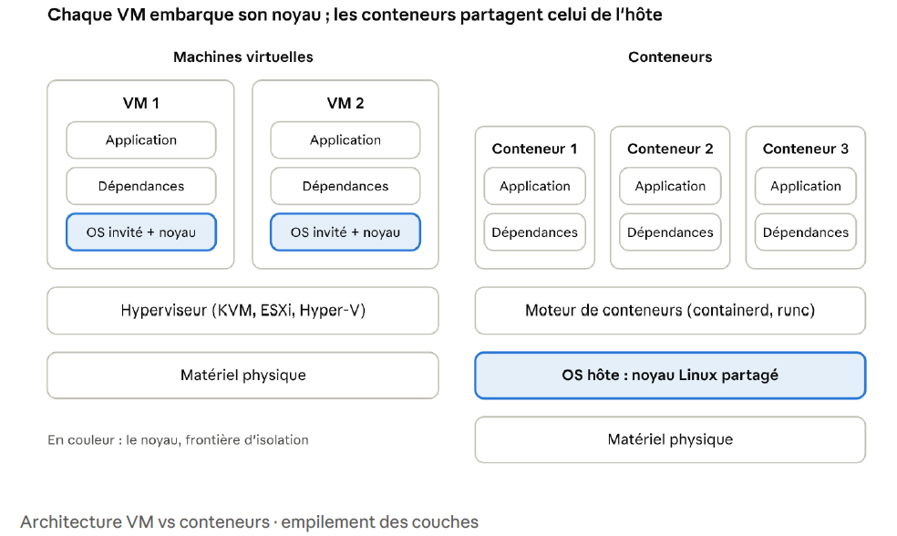
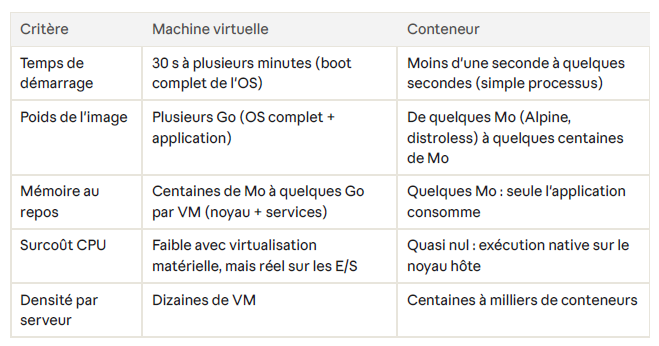

# Analyse : VM contre conteneur

## 1. Principe et fonctionnement

La différence fondamentale tient à la **couche virtualisée** : le **matériel** pour la VM, le **système d'exploitation** pour le conteneur.

- **Machine virtuelle** : un hyperviseur (type 1 comme *ESXi*, *Hyper-V* ou *KVM* ; type 2 comme *VirtualBox*) présente à chaque VM un matériel virtuel. Chaque VM exécute son propre **OS invité**, avec son noyau.
- **Conteneur** : un moteur (*Docker*, *containerd*, *Podman*) lance des processus isolés par le **noyau de l'hôte**. Le conteneur n'embarque que l'application et ses dépendances, **pas de noyau**.

## 2. Isolation 

La **VM** est isolée par le **matériel**, ce qui la rend très solide. Le **conteneur** est isolé par le **noyau**, avec des protections logicielles.

- **Machine virtuelle** : l'hyperviseur utilise les fonctions de virtualisation du processeur (*Intel VT-x*, *AMD-V*). Chaque VM a sa propre mémoire, son propre noyau et ses propres périphériques virtuels. Si une VM plante ou est piratée, le problème reste **enfermé dans cette VM**.
- **Conteneur** : l'isolation repose sur des outils du noyau Linux :
  - **Namespaces** : chaque conteneur a sa propre vue des processus, du réseau, des fichiers et des utilisateurs.
  - **Cgroups** : ils limitent ce que chaque conteneur peut consommer (CPU, mémoire, disque).
  - **Seccomp, AppArmor, SELinux** : ils limitent ce que le conteneur a le droit de faire.
Ces barrières sont logicielles et toutes appliquées par le même noyau. Une faille dans ce
noyau peut donc affecter tous les conteneurs de l'hôte.
Tous les conteneurs partagent **le même noyau** : une faille dans ce noyau peut donc **les toucher tous**.

 **Partage des ressources**

Une VM a ses ressources **réservées**. Les conteneurs **partagent** davantage les ressources de l'hôte : si leurs limites sont mal réglées, un conteneur trop gourmand peut ralentir les autres (effet **« voisin bruyant »**).

## 3. Performance
Le conteneur démarre en une seconde environ et pèse quelques dizaines de Mo, contre
plusieurs dizaines de secondes et plusieurs Go pour une VM.

## 4. Sécurité
Le noyau partagé est le point faible structurel du conteneur : une seule faille du noyau
suffit à menacer tout l'hôte.

Bonnes pratiques de durcissement des conteneurs :
Exécuter en utilisateur non root et activer les user namespaces (mode rootless).
Appliquer un profil seccomp et AppArmor/SELinux, et retirer les capabilities inutiles.
Utiliser des images minimales, scannées et signées.
Monter le système de fichiers en lecture seule et fixer des limites cgroups.

## 5. Point positif et negatif
| Critere     | Marchine Virtuelle | Conteneur    |
|---------|-----|----------|
| Isolation   | ✅ Forte, garantie par le matériel et l'hyperviseur  | ❌ Logique, dépend du noyau partagé    |
| Sécurité     | ✅ Surface d'attaque étroite (hyperviseur)  |   ❌ Une faille noyau ou runtime expose tout l'hôte   |
| Compatibilité OS   | ✅ N'importe quel OS invité (Windows sur hôte Linux, autre noyau)  | ❌ Même famille d'OS que l'hôte, même noyau|
| Temps de démarrage   | ❌ Dizaines de secondes à minutes  | ✅ Moins d'une seconde à quelques secondes|
| Portabilité   | ❌ Images lourdes, formats liés à l'hyperviseur  | ✅ Image standard OCI, identique du poste au cloud|
| Isolation des ressourceshloé   | ✅ CPU et mémoire réservés, peu de voisin bruyant8  | ❌ Partage accru, dépend du réglage des cgroups|
| Maintenance   | ❌ Un OS invité par VM à patcher et superviser  | ✅ Image immuable, reconstruite et redéployée|

## 6. Conclusion
VM et conteneur ne s'opposent pas : ils répondent à des compromis différents entre
isolation et efficacité.
**La VM reste la référence quand l'isolation prime** : code non fiable, multi-location, OS
hétérogènes ou exigences de conformité.
**Le conteneur s'impose quand la vitesse, la
densité et la portabilité priment** : microservices, CI/CD, applications cloud natives.
Le noyau partagé reste la limite de sécurité du conteneur. Il se compense par un
durcissement rigoureux ou par des solutions hybrides (micro-VM, Kata Containers,
gVisor) qui réconcilient les deux mondes.